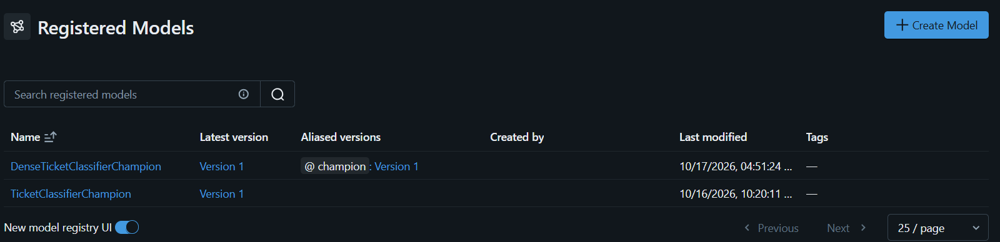
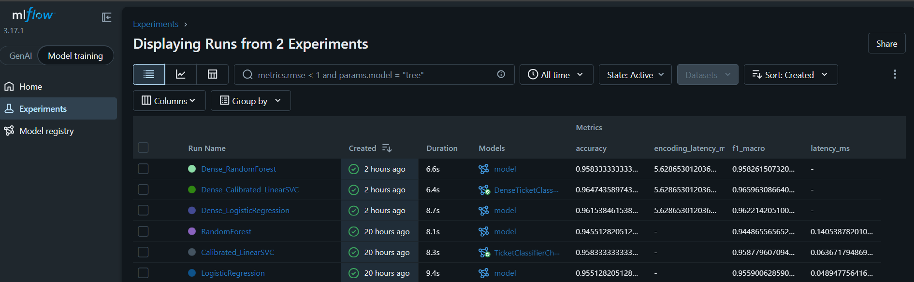
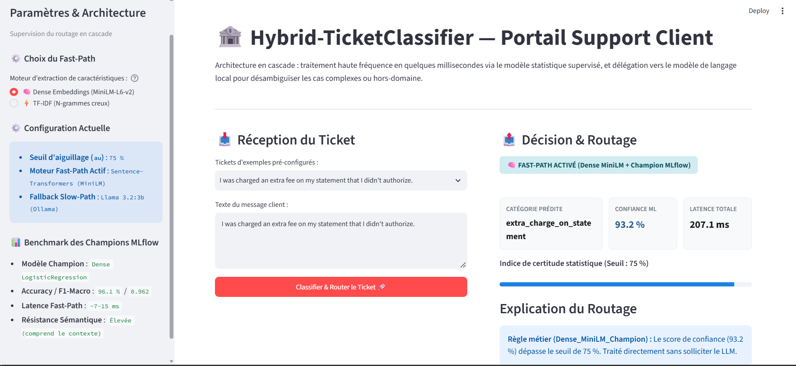
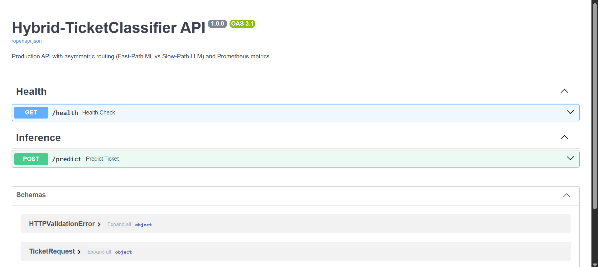

# 🏦 Hybrid-TicketClassifier: Production-Ready Asymmetric Routing Engine

> Système d'aiguillage asymétrique haute performance pour centres de contact bancaires : concilier l'inférence ultra-rapide (< 15 ms) du Machine Learning supervisé et l'arbitrage sémantique contextuel d'un LLM local contraint, sous gouvernance MLOps complète.

---

## 🛠️ Stack Technique & Écosystème

* **Core & Manipulation de Données :** Python 3.11+, NumPy, Pandas, Scikit-Learn, PyArrow.
* **Représentations Denses & NLP :** Sentence-Transformers (`all-MiniLM-L6-v2`), PyTorch, Torchvision.
* **Gouvernance MLOps & Registre :** MLflow (Suivi d'expérimentations, logging de métriques, Model Registry).
* **Slow-Path LLM Local :** Ollama (`llama3.2:3b`), Client OpenAI compatible (Inférence contrainte sous format JSON strict).
* **Interface Interactive Utilisateur :** Streamlit .
* **Serving & Observabilité Production :** FastAPI (OpenAPI 3.1 / Swagger UI), Uvicorn, Pydantic v2, Prometheus Client.

---

## 🎯 Problématique Métier & Justification d'Ingénierie

Dans les banques et services financiers traitant des dizaines de milliers de réclamations par jour, deux architectures classiques s'affrontent, chacune présentant une faille majeure :

1. **L'écueil du "Tout-LLM" :**
   * **Latence prohibitive :** Traiter chaque message via un modèle de langage génératif impose 2 à 8 secondes d'attente par ticket, incompatible avec un routage de flux en direct.
   * **Surcoût d'infrastructure :** Mobiliser des téraflops pour classer une demande triviale (*"où est ma carte ?"*) est un gaspillage de ressources de calcul.
   * **Risque d'hallucination :** Absence de garanties déterministes sur des taxonomies d'intentions fermées.

2. **L'écueil du "Tout-Machine Learning classique" :**
   * Les modèles statistiques légers (TF-IDF + LinearSVC) répondent en moins de 2 ms, mais souffrent du **syndrome du mot-clé isolé** :
     * Le message client *"hello my name is card"* active un faux positif à 84 % sur la classe `card_arrival`, uniquement à cause du mot `card`.
     * Incapacité à distinguer un réel incident bancaire d'un bavardage hors-domaine (*Out-of-Scope*).

### La solution : La Cascade Asymétrique
Le système traite les flux de manière hiérarchisée :
* **Niveau 1 — Garde-fous déterministes :** Interception immédiate des entrées invalides (chaînes vides, caractères spéciaux seuls, valeurs numériques sans contexte) sans calcul tensoriel.
* **Niveau 2 — Fast-Path Supervisé (80 à 85 % du volume) :** Inférence en quelques millisecondes via un classifieur calibré. Si la certitude statistique est forte ( > 75%), le ticket est routé instantanément.
* **Niveau 3 — Slow-Path LLM Local (15 à 20 % des cas résiduels) :** En cas d'hésitation statistique (< 75 %) ou d'ambiguïté, le LLM `llama3.2:3b` arbitre en temps réel pour trancher ou classer en `out_of_scope`.

---

## 🔬 Expérimentations Multi-Modèles & Traçabilité MLflow

Afin de déterminer la meilleure représentation vectorielle pour le Fast-Path, deux campagnes complètes d'entraînement et d'évaluation ont été journalisées sous **MLflow** sur le jeu de données **Banking77** (filtré sur 8 classes critiques) :

### Campagne 1 : Représentations Lexicales Creuses (TF-IDF)
* **Expérience MLflow :** `ticket_classifier_experiments`
* **Modèles évalués :** `LogisticRegression`, `Calibrated_LinearSVC`, `RandomForestClassifier`
* **Champion retenu :** `Calibrated_LinearSVC` (promu sous `TicketClassifierChampion`)

### Campagne 2 : Représentations Sémantiques Denses (Sentence-Transformers)
* **Expérience MLflow :** `ticket_classifier_embeddings_experiments`
* **Extracteur :** `all-MiniLM-L6-v2` (vecteurs denses de dimension 384)
* **Modèles évalués :** `Dense_LogisticRegression`, `Dense_Calibrated_LinearSVC`, `Dense_RandomForest`
* **Champion retenu :** `Dense_LogisticRegression` (promu sous l'alias officiel `@champion` dans le registre `DenseTicketClassifierChampion`)

*Figure 1 : MLflow Model Registry assurant le versionnage et le déploiement dynamique des modèles champions.*

*Figure 2 : Suivi comparatif des métriques (Accuracy, F1-Score, temps de calcul) dans MLflow UI.*

---

## ⚖️ Synthèse Comparative : TF-IDF vs Sentence-Transformers

| Dimension | Approche TF-IDF (N-grammes 1-2) | Approche Dense MiniLM (384d) |
| :--- | :--- | :--- |
| **Modèle Champion** | `Calibrated LinearSVC` | `Dense LogisticRegression` |
| **Accuracy / F1-Macro** | 95.0 % / 0.952 | **96.15 % / 0.9622** |
| **Latence d'inférence** | **~1.5 ms** (Ultra-haute fréquence) | **~10 à 15 ms** (Temps réel strict) |
| **Sensibilité au contexte** | Faible (Sac de mots déconnecté) | **Élevée (Capture l'intention globale)** |
| **Résistance aux pièges lexicaux** | Vulnérable aux formulations trompeuses | **Robuste face aux mots-clés isolés** |
| **Étalonnage des probabilités** | Nécessite un scaling sigmoïde (Platt Scaling) | Naturellement étalonné via Softmax |

**Décision d'architecture :**  
Bien que TF-IDF affiche une latence record, le passage aux représentations denses élimine les faux positifs syntaxiques tout en respectant scrupuleusement les contraintes de latence d'une infrastructure de production (< 20 ms).

---

## 🛡️ Résilience & Arbitrage LLM Contraint

Pour fiabiliser l'intervention du modèle de langage local (`llama3.2:3b`) :
1. **Désambiguïsation contrainte sur Top-2 :** Le LLM n'a pas à choisir sur l'ensemble de la nomenclature ; il reçoit uniquement les **deux catégories les plus probables** identifiées par le modèle statistique ou l'option `out_of_scope`.
2. **Garantie structurelle JSON :** La réponse est obligatoirement un objet JSON (`{"category": "...", "reason": "..."}`), éliminant tout bavardage non parsable.
3. **Immunité aux formules de politesse :** Le prompt système instruit formellement le LLM d'ignorer les présentations personnelles (*"Hello, my name is..."*) pour isoler l'intention bancaire réelle (*"my transfer is delayed"*).

---

## 🖥️ Application Utilisateur Interactive (Streamlit)

L'interface Streamlit a été conçue comme un **banc d'essai et de supervision opérationnelle** :

* **Comparateur dynamique en temps réel :** La barre latérale intègre un sélecteur permettant à l'utilisateur de basculer instantanément entre le moteur **⚡ TF-IDF** et le moteur **🧠 Dense Embeddings** pour visualiser immédiatement la différence de comportement sur un même texte.
* **Supervision du routage :** Un système de badges colorés identifie clairement le composant ayant pris la décision :
  * `🛡️ GARDE-FOU DÉTERMINISTE` : Ticket éliminé en amont .
  * `⚡ FAST-PATH ACTIVÉ` : Traitement statistique rapide en quelques millisecondes.
  * `🤖 SLOW-PATH ACTIVÉ` : Arbitrage contextuel par le LLM local.
* **Métriques temps réel :** Affichage pour chaque prédiction de la catégorie, de la certitude statistique calibrée, de la latence mesurée de bout en bout et de l'explication textuelle du choix.

*Figure 3 : Interface Streamlit démontrant la cascade de décision et le monitoring de latence.*

---

## 🔌 API de Production & Observabilité (FastAPI & Prometheus)

Pour répondre aux exigences d'intégration microservices, le projet fournit une API REST asynchrone complète, documentée et instrumentée nativement pour les plateformes de supervision d'entreprise.

### 1. Endpoints de l'API
* `POST /predict` : Reçoit le texte du ticket et le choix du moteur (`"dense"` ou `"tfidf"`), exécute la cascade et retourne la décision structurée.
* `GET /health` : Contrôle d'état (*Healthcheck*).
* `GET /metrics/` : Exposition des métriques au format standard Prometheus pour le scraping automatique.

### 2. Documentation Interactive OpenAPI (Swagger UI)
L'API génère automatiquement son schéma OpenAPI standardisé, permettant de tester les contrats d'interface directement dans le navigateur :

*Figure 4 : Documentation interactive Swagger UI (`/docs`) exposant les endpoints et schémas de données Pydantic.*

### 3. Métriques Prometheus Intégrées
* `ticket_classifier_requests_total` : Compteur dimensionné par `engine` (dense/tfidf), `routed_by` (Fast-Path/Slow-Path/Guardrail) et `category`.
* `ticket_classifier_latency_seconds` : Histogramme de latence distribué par composant de décision, permettant de suivre les SLA en direct sous Grafana.

🚀 Guide de Démarrage Complet (Step-by-Step)

Ce guide décrit l'intégralité des étapes pour reproduire l'environnement, régénérer les modèles MLOps, et exécuter simultanément l'interface utilisateur, l'API de serving et le serveur de métriques.

Étape 1 : Cloner le dépôt et initialiser l'environnement

Ouvrez un terminal PowerShell :

# 1. Cloner le projet
git clone <URL_DU_DEPOT>
cd hybrid-ticket-classifier

# 2. Créer l'environnement virtuel Python
python -m venv venv

# 3. Activer l'environnement virtuel
.\venv\Scripts\Activate.ps1

# 4. Installer les dépendances
python -m pip install --upgrade pip
pip install -r requirements.txt

Étape 2 : Préparer les données et entraîner les modèles champions (MLflow)

Cette étape télécharge et prépare le jeu de données Banking77, exécute les deux campagnes de benchmark et enregistre les deux modèles gagnants dans le MLflow Model Registry :

# 1. Prétraitement et partitionnement du dataset (train/test)
python -m src.data_prep

# 2. Campagne TF-IDF : Entraînement multi-modèles et promotion de TicketClassifierChampion
python -m src.train

# 3. Campagne Dense Embeddings : Encodage MiniLM et promotion de DenseTicketClassifierChampion
python -m src.train_embeddings

Étape 3 : Démarrer le serveur de tracking MLOps (MLflow UI)

Pour examiner les courbes d'apprentissage, comparer les modèles et vérifier le Model Registry :

Dans un nouveau terminal (avec l'environnement virtuel venv activé) :

mlflow ui

🌐 Accédez à l'interface sur : http://localhost:5000

Vous y trouverez les expériences ticket_classifier_experiments, ticket_classifier_embeddings_experiments et l'onglet Registered Models.

Étape 4 : Démarrer le modèle LLM Local (Ollama)

Le Slow-Path s'appuie sur le modèle llama3.2:3b exécuté localement :

Dans un nouveau terminal :

# Vérifier et lancer le modèle Ollama
ollama run llama3.2:3b

(Laissez le service ou le terminal Ollama actif en arrière-plan).

Étape 5 : Lancer l'Application Interactive (Streamlit)

Pour tester le système via l'interface graphique de démonstration et de supervision :

Dans un nouveau terminal (avec l'environnement virtuel venv activé) :

python -m streamlit run app.py

🌐 L'application s'ouvre automatiquement sur : http://localhost:8501

Utilisez la barre latérale pour basculer entre le moteur TF-IDF et le moteur Dense MiniLM, ajuster les seuils de confiance et observer l'aiguillage en cascade.

Étape 6 : Lancer l'API REST de Production & Métriques (FastAPI)

Pour exposer les endpoints d'inférence microservices et le scraping Prometheus :

Dans un nouveau terminal (avec l'environnement virtuel venv activé) :

python -m uvicorn src.api:app --host 0.0.0.0 --port 8000 --reload

📘 Documentation interactive Swagger UI : http://localhost:8000/docs (test des requêtes POST /predict en direct)

🩺 Contrôle d'état (Healthcheck) : http://localhost:8000/health

📊 Scraping des métriques Prometheus : http://localhost:8000/metrics/
